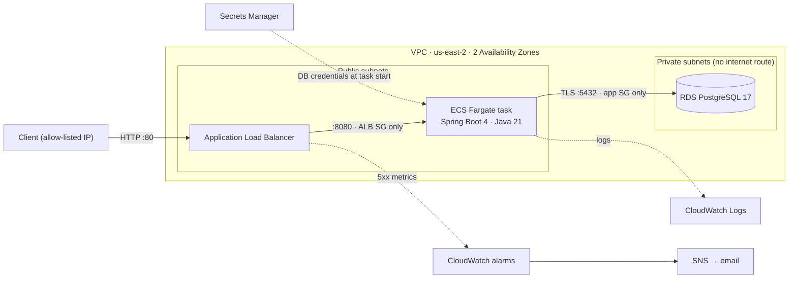
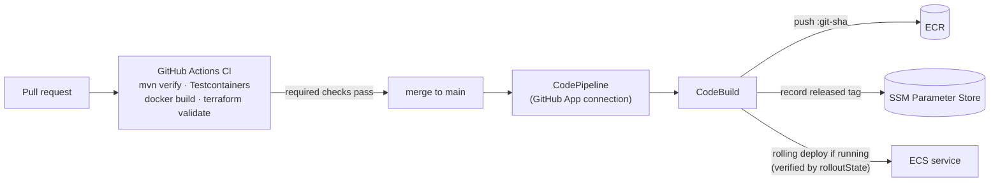

# Transaction Ledger API

[](https://github.com/NickLesho/ledger-api/actions/workflows/ci.yml)

A REST API for accounts and money transfers with **idempotency keys**, **deadlock-free row locking**
and **exact decimal money handling**, deployed on **AWS ECS Fargate** with **Terraform** and a
**CI/CD pipeline that holds no stored AWS keys**.

**Stack:** Java 21 · Spring Boot 4 · PostgreSQL 17 · Flyway · JUnit 5 · Testcontainers · Docker ·
AWS (ECS Fargate, ALB, RDS, Secrets Manager, ECR, CloudWatch, CodePipeline, CodeBuild) · Terraform · GitHub Actions

---

## Architecture



### Delivery pipeline



---

## API

| Method | Path | Description |
|---|---|---|
| `POST` | `/accounts` | Create an account (`owner`, `currency`, `openingBalance`) |
| `GET` | `/accounts/{id}` | Get an account and its balance |
| `GET` | `/accounts/{id}/transfers?page=0&size=20` | Transfer history, newest first |
| `POST` | `/transfers` | Move money; **requires an `Idempotency-Key` header** |

| Situation | Status | Problem `type` |
|---|---|---|
| Transfer completed | `201` | – |
| Retry with the same key | original status + `Idempotent-Replayed: true` | – |
| Malformed or invalid request | `400` | `validation-failed` / `invalid-request` |
| Account not found | `404` | `account-not-found` |
| Same key, different payload | `409` | `idempotency-key-reused` |
| Insufficient funds / currency mismatch | `422` | `insufficient-funds` / `currency-mismatch` |

All errors are [RFC 9457](https://www.rfc-editor.org/rfc/rfc9457) `application/problem+json`.

```bash
curl -X POST localhost:8080/transfers \
  -H 'Content-Type: application/json' -H 'Idempotency-Key: 7f9c...' \
  -d '{"fromAccountId":"...","toAccountId":"...","amount":"30.00"}'
```

---

## Key design decisions

**Idempotency.** Every transfer carries an `Idempotency-Key`. A retry with the same key returns the
original result (including a rejected 422) instead of moving money twice. The key is checked again
*after* the row locks are acquired, so two concurrent retries can't both execute; a database unique
constraint is the final guard for same-key/different-payload races.

**Deadlock-free locking.** A transfer locks both account rows with `SELECT … FOR UPDATE`, always in
ascending ID order regardless of direction. A→B and B→A therefore queue on the same first row instead
of each holding one lock and waiting on the other.

**Money.** `BigDecimal` in Java, `NUMERIC(19,2)` in Postgres, strings in JSON (`"70.00"`) so no client
parses money as a floating-point number. Amounts with more than two decimals are rejected, never rounded.

**Defense in depth.** Bean Validation at the API, invariant checks in the domain, and `CHECK`/`UNIQUE`
constraints in the schema (non-negative balance, positive amounts, no self-transfers).

**Fargate vs Lambda.** This is a steady, connection-pooled API. Lambda would bring cold starts and
connection storms against RDS (or require RDS Proxy); Fargate runs the exact container tested locally,
with no servers to manage and per-second billing.

**Security.** No long-lived credentials anywhere: developers use `aws login` (temporary STS
credentials), CodeBuild uses a scoped IAM role, and the DB password is generated by RDS, stored in
Secrets Manager and injected at container start. Three security groups chain internet → ALB → app → DB.
The container has **no task role**, so a compromised container holds no AWS credentials.

**Why CodePipeline instead of GitHub OIDC.** The AWS account runs under organization guardrails that
deny creating IAM identity providers. Rather than store access keys in GitHub, deployment moved into
AWS via a GitHub App connection; GitHub Actions verifies code with no AWS access at all. `main` is
protected: changes merge only through pull requests whose CI checks pass.

**Cost.** Runs on the AWS Free plan ($0 billed). No NAT gateway, smallest RDS/Fargate sizes, ALB
locked to an allow-listed IP, and a two-layer Terraform design so the paid layer is destroyed after
every session and recreated in ~15 minutes.

---

## Testing

- **Unit tests** (Mockito): transfer logic, lock ordering, idempotent replay, validation.
- **Integration tests** (`@SpringBootTest` + Testcontainers, real Postgres 17 over real HTTP), including:
  - two concurrent 60.00 transfers from a 100.00 account → exactly one `201`, one `422`, balance 40.00
  - opposing A→B / B→A transfers under contention → no deadlocks, total conserved
  - concurrent retries with the same key → money moves once

```bash
./mvnw verify   # unit (Surefire) + integration (Failsafe); Docker must be running
```

---

## Run locally

Requirements: JDK 21, Docker.

```bash
docker compose --profile app up -d --build     # Postgres + the app on :8080
curl localhost:8080/actuator/health
```

Or run Postgres in Docker and the app from your IDE: `docker compose up -d` then `./mvnw spring-boot:run`.

---

## Deploy to AWS

Infrastructure is three Terraform configurations sharing an S3 backend:

| Layer | Path | Contents | Lifetime |
|---|---|---|---|
| bootstrap | `infra/bootstrap` | State bucket | Once |
| core | `infra` | VPC, ECR, CI/CD pipeline, SNS, SSM | Permanent, ~$0 |
| app | `infra/app` | RDS, ALB, ECS, alarms | Created/destroyed per session |

```bash
terraform -chdir=infra/app init -backend-config=backend.hcl
terraform -chdir=infra/app apply      # ~15 min; deploys the image recorded in SSM by the pipeline
terraform -chdir=infra/app destroy    # ~10 min
```
Copy each `terraform.tfvars.example` to `terraform.tfvars` and fill in your values first.

---

## Observability

ECS task logs ship to CloudWatch Logs (`/ecs/ledger-api`, 7-day retention). CloudWatch alarms on
ALB-generated and application 5xx responses notify by email through SNS. CodeBuild logs go to
`/codebuild/ledger-api`.

---

## What I'd change for production

- HTTPS listener with an ACM certificate; HTTP → HTTPS redirect.
- Tasks in private subnets behind NAT or VPC endpoints, with egress control.
- RDS Multi-AZ, longer backup retention, deletion protection; `sslmode=verify-full`.
- A least-privilege `ledger_app` database role instead of the master user; react to secret rotation.
- Authentication and per-client idempotency-key scoping.